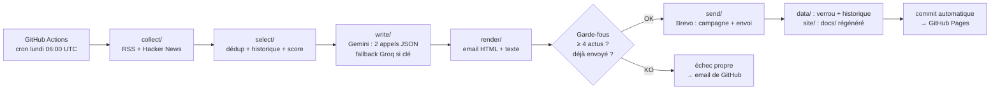

# L'IA sans jargon — newsletter IA & data 100 % automatique et gratuite

Chaque **lundi à 06:00 UTC**, sans aucune intervention humaine, ce dépôt :

1. **collecte** les actus IA et data des 7 derniers jours (21 flux RSS + Hacker News) ;
2. **sélectionne** les plus importantes (déduplication, historique, score) ;
3. les fait **résumer et vulgariser en français** par Google Gemini (offre gratuite) ;
4. génère un **email HTML** propre (+ version texte) ;
5. l'**envoie** à tous les abonnés via **Brevo** (offre gratuite) ;
6. **publie** le numéro sur le site **GitHub Pages** (landing + inscription, archives, RSS, sitemap).

Coût : **0 €** (GitHub Actions + GitHub Pages + Gemini gratuit + Brevo gratuit). Aucun serveur.

> Configuration initiale (une seule fois, ~30 min) : suivez **[SETUP.md](SETUP.md)**.
> Choix techniques et justifications : **[DECISIONS.md](DECISIONS.md)**.

---

## Le pipeline



| Étape | Dossier | Détail |
|---|---|---|
| Collecte | `newsletter/collect/` | Flux listés dans `config/sources.yaml`. User-Agent explicite, timeouts, 3 retries. Une source en panne est ignorée (log), jamais bloquante. |
| Sélection | `newsletter/select/` | Déduplication par URL normalisée et similarité de titres (sans modèle lourd), exclusion de tout ce qui est dans `data/history.json`, score = récence + nombre de médias qui couvrent le sujet + poids de la source + mots-clés grand public. Les 25 meilleurs vont à l'IA. |
| Rédaction | `newsletter/write/` | **2 appels IA par numéro** (plafond dur : 6 avec les retries) : 1) classement des candidats, 2) rédaction complète en JSON strict validé par pydantic. Les **liens ne viennent jamais de l'IA** : chaque texte est rattaché à son article par identifiant. |
| Rendu | `newsletter/render/` + `newsletter/templates/email/` | HTML 600 px, une colonne, CSS inline, sans JavaScript ; version texte. |
| Envoi | `newsletter/send/` | API Brevo : création de campagne vers la liste, puis envoi immédiat. Lien de désinscription Brevo dans chaque email. |
| Site | `newsletter/site/` + `newsletter/templates/site/` | Généré dans `docs/` : landing + formulaire, `/archives/`, une page par numéro, `feed.xml`, `sitemap.xml`, Open Graph. |
| Orchestration | `main.py` | Enchaîne le tout, gère les garde-fous et les codes de sortie. |

### Garde-fous

- **Moins de 4 actus valides** → aucun envoi, le workflow échoue proprement (GitHub vous envoie un email).
- **Jamais deux fois le même numéro** : verrou `data/locks/AAAA-Www.json` (semaine ISO) **et** vérification côté Brevo qu'aucune campagne `[AAAA-Www]` n'est déjà partie. Les exécutions ne peuvent pas se chevaucher (`concurrency`).
- **Les tests tournent avant chaque envoi** : si le code est cassé, rien ne part.
- **IA** : JSON validé par schéma ; si invalide → nouvel essai avec le message d'erreur ; 429 → backoff exponentiel (en respectant le délai demandé par Google) ; modèle disparu → modèle Gemini suivant → fournisseur de secours (si clé). Si la sélection IA échoue, on se rabat sur le classement par score.
- **Aucune donnée d'abonné dans le dépôt** : la liste vit uniquement chez Brevo.

---

## Commandes locales

```bash
python -m venv .venv && .venv/Scripts/activate      # Windows (Linux/Mac : source .venv/bin/activate)
pip install -r requirements-dev.txt

python main.py --dry-run --mock   # numéro de simulation (sans IA), sources réelles → output/
python main.py --dry-run          # idem avec l'IA si GEMINI_API_KEY est définie
python main.py --site-only        # régénère docs/ depuis data/issues/
python -m pytest                  # tests (sans réseau)
```

Le dry-run écrit `output/issue.html` (l'email), `output/issue.txt`, `output/issue.json` et un aperçu du site dans `output/site/`. **Il n'envoie rien et ne modifie ni `data/` ni `docs/`.**

---

## Personnaliser

### Modifier les sources
Éditez `config/sources.yaml` : ajoutez un bloc (`id`, `name`, `type: rss`, `url`, `lang`, `weight`), mettez `enabled: false` pour couper une source, `filter: true` pour un média généraliste (on ne garde alors que les articles qui parlent d'IA / data, selon `topic_keywords` de `config/settings.yaml`). Testez avec `python main.py --dry-run --mock` : les logs affichent le nombre d'articles par source.

### Modifier le ton ou la structure des textes
Tout est dans `prompts/` :
- `prompts/system.md` : ton, public, règles anti-hallucination ;
- `prompts/select.md` : critères de choix des actus ;
- `prompts/write.md` : structure et longueurs de chaque rubrique.

Gardez les variables `${...}` et le format JSON demandé. La mise en page est dans `newsletter/templates/`.

### Changer le nom de la newsletter
`config/settings.yaml` → `newsletter.name` (et `sender_name`, `tagline`). Le site est régénéré automatiquement au prochain push (workflow « Reconstruire le site »).

### Ajouter des « outils à tester »
`config/tools.yaml` (40 outils fournis ≈ 9 mois). Quand la liste est épuisée, l'IA en propose un (sans lien) et un avertissement apparaît dans les logs.

### Changer de modèle IA (si le modèle gratuit disparaît)
Les modèles gratuits changent régulièrement. Trois niveaux de protection :
1. **Automatique** : si le modèle principal n'existe plus, le programme essaie `gemini-flash-latest` puis `gemini-3.5-flash-lite` (liste `ai.gemini_backup_models` dans `config/settings.yaml`).
2. **Sans toucher au code** : sur GitHub → *Settings → Secrets and variables → Actions → onglet Variables* → créez/modifiez la variable `GEMINI_MODEL` (ex. `gemini-3.8-flash`). La liste des modèles est sur <https://ai.google.dev/gemini-api/docs/models> ; choisissez un modèle « Flash » marqué gratuit sur la page des tarifs.
3. **Fournisseur de secours** : ajoutez le secret `FALLBACK_API_KEY` (clé Groq gratuite, voir SETUP.md). Modèle et URL modifiables via les variables `FALLBACK_MODEL` et `FALLBACK_BASE_URL` (tout service compatible OpenAI, ex. OpenRouter : `https://openrouter.ai/api/v1` avec un modèle `:free`).

---

## Pourquoi un workflow « keepalive » ?

GitHub **désactive les workflows planifiés d'un dépôt public après 60 jours sans activité**. Le commit hebdomadaire de la newsletter (historique + site) suffit normalement. Mais si la newsletter échoue plusieurs semaines de suite (sources en panne, quota…), plus rien n'est commité et, au bout de 60 jours, le cron s'arrêterait en silence.

`.github/workflows/keepalive.yml` tourne le 1er de chaque mois : si aucun commit depuis 25 jours, il écrit la date dans `data/keepalive.txt` et commite ; dans tous les cas il réactive le workflow de la newsletter s'il a été désactivé. Vous n'avez rien à faire.

---

## Workflows GitHub Actions

| Fichier | Quand | Rôle |
|---|---|---|
| `newsletter.yml` | lundi 06:00 UTC + manuel | Tests, puis génération et envoi. Manuel : option `dry_run` (cochée par défaut) et `force`. Commite `data/` et `docs/`. L'aperçu est joint au run (« Artifacts »). |
| `tests.yml` | chaque push / PR | pytest (Python 3.11 et 3.13), actionlint, dry-run de simulation. |
| `site.yml` | push sur `config/` ou gabarits du site | Régénère `docs/` sans envoyer d'email. |
| `keepalive.yml` | 1er du mois | Anti-désactivation (voir ci-dessus). |

## Limites connues des offres gratuites

- **Brevo gratuit : 300 emails / jour** → jusqu'à ~300 abonnés (au-delà, passer à une offre payante ou changer de service). Le logo Brevo apparaît en bas des emails.
- **Gemini gratuit** : quotas journaliers par modèle, largement suffisants (2 appels / semaine). Les données envoyées à l'offre gratuite peuvent servir à Google pour améliorer ses produits (ce ne sont que des titres et extraits d'articles publics).
- **Résumés IA** : l'IA ne voit que le titre et l'extrait de chaque article (pas l'article complet) ; elle a pour consigne stricte de ne rien inventer, et chaque résumé renvoie vers sa source.

## Structure

```
main.py                     orchestrateur
config/                     settings.yaml, sources.yaml, tools.yaml (public, sans secret)
prompts/                    prompts de l'IA (modifiables)
newsletter/                 collect/ select/ write/ render/ send/ site/ templates/
data/                       history.json, locks/, issues/ (commités par le workflow)
docs/                       site GitHub Pages (généré)
tests/                      pytest + fixtures (sans réseau)
.github/workflows/          newsletter, tests, site, keepalive
```

> Les modules sont regroupés dans le package `newsletter/` : un dossier `select/` à la racine masquerait le module `select` de la bibliothèque standard Python et casserait les requêtes réseau (voir DECISIONS.md).
